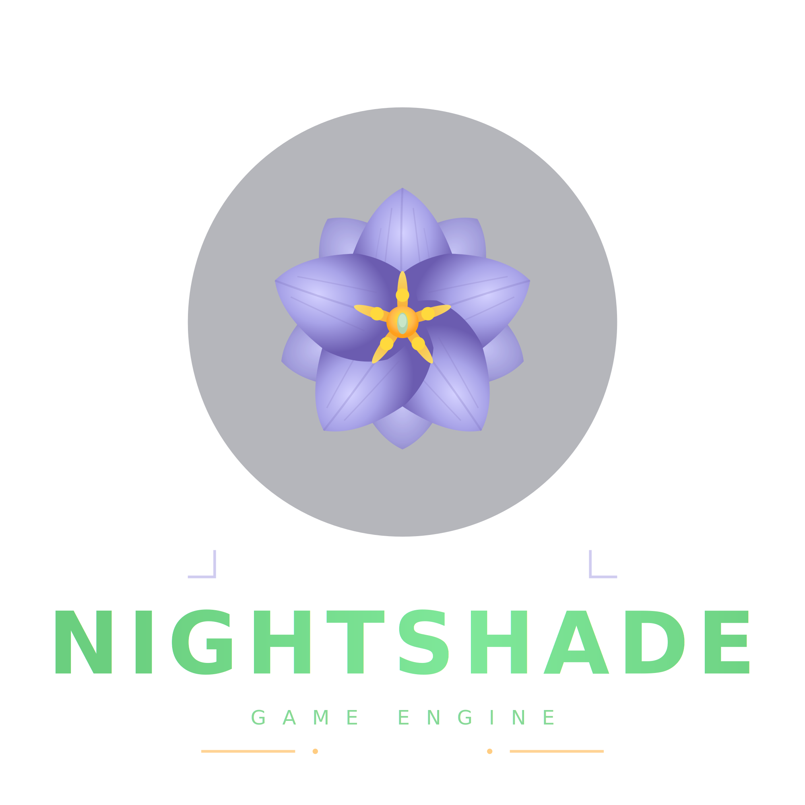

<p align="center">
  
</p>

<p align="center">
  <a href="https://github.com/matthewjberger/nightshade"></a>
  <a href="https://crates.io/crates/nightshade"></a>
  <a href="https://docs.rs/nightshade"></a>
</p>

`Nightshade` is a data-oriented game engine written in rust 🦀


## Gallery

[View the gallery here](https://matthewberger.dev/nightshade) 🔎
 


## Getting Started

The fastest way to get started is with the [nightshade-template](https://github.com/matthewjberger/nightshade-template).

## Examples

For a collection of example projects showcasing Nightshade's features, see the [nightshade-examples](https://github.com/matthewjberger/nightshade-examples) repository.

## Features

Nightshade uses a modular feature system for fine-grained dependency control.

### Feature Hierarchy

```
nightshade features:
├── core ─────────────── Minimal: windowing, math, ECS, time
├── text ─────────────── 3D text rendering (fontdue)
├── assets ───────────── Asset loading (gltf, image, half, bincode)
├── runtime ──────────── core + text (minimal runnable app)
├── engine (default) ─── runtime + assets + scene_graph + picking + more
└── full ─────────────── Everything including audio, physics, navmesh, scripting
```

### Binary Size by Feature

| Configuration | Size | Delta |
|--------------|------|-------|
| runtime+wgpu (baseline) | 9.71 MB | - |
| +egui | 15.82 MB | +6.11 MB |
| +physics (rapier3d) | 10.95 MB | +1.24 MB |
| +assets | 10.28 MB | +0.57 MB |
| +gamepad | 10.21 MB | +0.50 MB |
| +terrain | 10.21 MB | +0.50 MB |
| +audio (kira) | 10.11 MB | +0.40 MB |
| +navmesh | 9.71 MB | +0.00 MB |
| engine (default) | 10.79 MB | +1.08 MB |
| full | 22.63 MB | +12.92 MB |

### Minimal Build

For a lightweight egui app without asset loading:

```toml
nightshade = { default-features = false, features = ["runtime", "wgpu", "egui"] }
```

## Quickstart

```bash
# native
just run

# wasm (webgpu)
just run-wasm

# serve site
cd site && just serve
```

> All chromium-based browsers like Brave, Vivaldi, Chrome, etc support WebGPU.
> Firefox also [supports WebGPU](https://mozillagfx.wordpress.com/2025/07/15/shipping-webgpu-on-windows-in-firefox-141/) now starting with version `141`.
> Run `just` with no arguments to list all commands

## Prerequisites

* [just](https://github.com/casey/just)
* [trunk](https://trunkrs.dev/) (for web builds)
* [git-cliff](https://git-cliff.org/) (for changelog generation)
* [gh](https://cli.github.com/) (GitHub CLI, for creating releases)

## Platform Guides

### Native (Windows/macOS/Linux)

Build and run natively using cargo:

```bash
just run [project]  # defaults to nightshade-editor
just build          # release build
```

### WebAssembly (WASM)

Build for web browsers with WebGPU support:

```bash
just run-wasm [project]   # defaults to editor
just build-wasm [project]
```

### Steam Deck

See [STEAM_DECK.md](docs/STEAM_DECK.md) for deployment instructions.

### Steam Integration

See [STEAM.md](docs/STEAM.md) for Steam integration (achievements, stats, friends).

### Profiling & Logging

See [PROFILING.md](docs/PROFILING.md) for detailed profiling and logging documentation.

### Plugins

See [PLUGINS.md](docs/PLUGINS.md) for runtime WASI plugin support.

### Scripting

See [SCRIPTING.md](docs/SCRIPTING.md) for Rhai scripting support.

## Contributing

Nightshade is currently in its early stages of development. The project is not accepting external contributions at this time as the architecture and core systems are still being established. Once the engine reaches a more mature and stable state, I will open up contributions and provide contributor guidelines.

## License

Nightshade is free, open source and permissively licensed! All code in this repository is dual-licensed under either:

* MIT License ([LICENSE-MIT](LICENSE-MIT) or http://opensource.org/licenses/MIT)
* Apache License, Version 2.0 ([LICENSE-APACHE](LICENSE-APACHE) or http://www.apache.org/licenses/LICENSE-2.0)

at your option.

Unless you explicitly state otherwise, any contribution intentionally submitted for inclusion in `nightshade` by you, as defined in the Apache-2.0 license, shall be dual licensed as above, without any additional terms or conditions.
