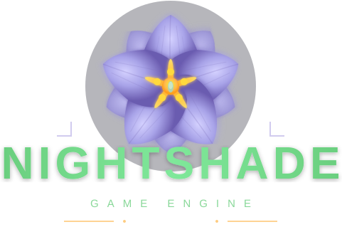

<p align="center">
  
</p>

<p align="center">
  <a href="https://github.com/matthewjberger/nightshade"></a>
</p>

`Nightshade` is a data-oriented 3D game engine written in Rust. It targets native (Windows, macOS, Linux) and the web via WebGPU, and ships a glTF-first PBR renderer with the full KHR extension set.

> Pre-1.0. APIs are still shifting and the project is not yet accepting external contributions. The renderer and ECS are usable today on Windows, Linux, and modern Chromium / Firefox builds.

## Getting Started

Clone the repository and work inside it. The engine builds from source.

```bash
git clone --no-tags https://github.com/matthewjberger/nightshade.git
cd nightshade
```

Install [just](https://github.com/casey/just), then:

```bash
just install-deps
just run
```

Run `just` with no arguments to list every recipe.

To start a game, copy `template/` anywhere and build on it.

```bash
cp -r template ../my-game
cd ../my-game
```

The template reaches the engine by relative path, so repoint it at wherever
the repository sits. In `Cargo.toml`:

```toml
nightshade = { path = "../nightshade/crates/nightshade", optional = true }
nightshade-camera = { path = "../nightshade/crates/plugins/domain/nightshade-camera", optional = true }
nightshade-camera-controller = { path = "../nightshade/crates/plugins/domain/nightshade-camera-controller", optional = true }
nightshade-graphics = { path = "../nightshade/crates/plugins/domain/nightshade-graphics", optional = true }
nightshade-log = { path = "../nightshade/crates/plugins/domain/nightshade-log", optional = true }
nightshade-platform = { path = "../nightshade/crates/plugins/describe/nightshade-platform", optional = true }
nightshade-scene = { path = "../nightshade/crates/plugins/describe/nightshade-scene", optional = true }
nightshade-wgpu = { path = "../nightshade/crates/plugins/compose/nightshade-wgpu", optional = true }
nightshade-window = { path = "../nightshade/crates/plugins/compose/nightshade-window", optional = true }
```

Then:

```bash
just run
```

## Android

`just build-android` writes an installable apk to `target/x/release/android/`,
and `just run-android` builds, installs, and starts it on a connected device.
Both take an app name and default to the template.

`just init-android` adds the `aarch64-linux-android` target, installs the
packager, and runs its doctor. The packager brings its own NDK, so the machine
needs a JDK, clang, and the platform tools rather than a full NDK install.
Anything in the graph that compiles C or C++ goes through the `cc` crate, and a
host clang carries no android headers, so the recipes point it at a sysroot:
`ANDROID_NDK_SYSROOT` if set, then a full `ANDROID_NDK_ROOT` install, then the
one the packager bundles. A missing sysroot is reported up front instead of as
a header cc cannot find.

An app is a library as well as a binary, because `NativeActivity` loads the
library and calls `android_main` in it, so `main` never runs:

```toml
[lib]
crate-type = ["cdylib", "rlib"]
```

The `android_main!` macro declares that entry point. It records the activity
handle, which the event loop needs before winit can build one, then calls the
function that composes and runs the app:

```rust
pub fn launch() -> Result<(), Box<dyn std::error::Error>> {
    App::new().add_plugin(WindowPlugin::default()).run()
}

nightshade_platform::android_main!(launch);
```

It expands to nothing on every other target, so `main.rs` stays the desktop
entry point.

Two files sit beside `Cargo.toml`. `X.toml` names the package for the packager,
and `manifest.yaml` describes the activity. The template carries both.

Android takes the native window away when an app leaves the foreground. That
invalidates the presentation surface but not the device, so the renderer
releases only the surface and keeps everything else. Every uploaded mesh,
texture, and pipeline stays valid, and so does the world's record of what the
renderer already knows.

Logs go to logcat, tagged with the window title, so `just logcat-android
Template` follows a running app. An activity has no environment, so `RUST_LOG`
never reaches the filter and nothing outside the build can raise it. The
graphics backends are turned up on android, because wgpu reports a backend that
failed to start at debug and says nothing at info.

Assets are not on a filesystem the app can reach by relative path. Anything a
build ships should be compiled in with `include_bytes!` or `include_str!`.
There is no clipboard and no browser reachable from native code, so those calls
report that the host declined. Touch arrives as touch and also as a synthesized
left mouse button, so a pointer-driven app responds.

The Android emulator commonly has no usable Vulkan under either `-gpu host` or
`-gpu swiftshader_indirect`, so it is not a way to test rendering.

## Architecture

The ECS, then the substrate, then fifty-four plugin crates in four levels.
Every edge points down, and `just lint-dag` fails the build if one ever points
back.

```
                    nightshade-ecs
                    archetype storage, schedules, resources, events
                            |
                    nightshade
                    App, Plugin, Stage, World
                            |
    nightshade-platform    nightshade-scene      nightshade-render
    the window, the        transforms, the       the frame description
    input, the clock       hierarchy, the guid   both backends read
                            |
                    nightshade-graphics
                    the asset loading, the world spawners,
                    and the nine CPU passes
                            |
        nightshade-wgpu              nightshade-vulkan
        the wgpu backend             the Vulkan backend
        and the render graph         and its ordered pass list
                            |
                    nightshade-window
                    the winit runner and the event loop
                            |
                    the seventeen draw crates and
                    the rest of the capabilities
```

`nightshade` is two files. It names `nightshade-ecs` and nothing else in the
band, so `App` does not rebuild when a capability changes, and it holds no
capability and no GPU API of its own.

`nightshade-platform` and `nightshade-scene` sit beside each other above it and
carry the vocabulary almost every capability speaks. Seventeen crates take one or
both as a contract, so naming a window or a transform links no behavior.

`nightshade-render` is the frame description and nothing else: the materials,
the meshes, the textures, the lights, the render config, and the math both
backends would otherwise write twice. It names no GPU API and carries no
system, and 153 manifests name it. `nightshade-graphics` is what runs over
that description on the CPU, so a plugin that publishes meshes, materials, or
lights reads it without linking a renderer.

`nightshade-wgpu` holds the wgpu backend and the render graph, and
`nightshade-window` holds the winit runner, so a host that drives its own loop
takes the renderer without the event loop. `nightshade-vulkan` is the sibling
reading the same frame description. Each backend shows two paths and keeps its
`renderer` module private, and `just lint-dag` fails on a `backend` path the
facade list does not carry.

Inside a crate the same rule holds one level down. Per-entity data lives in
`components`, shared data in `resources`, plain values in `data`, frame
behavior in `systems`, the functions that change a resource in `commands`, and
the functions that only report in `queries`. `just lint-dag` fails on a module
cycle inside any crate.

### The directory structure

```
crates/
  nightshade-ecs/        archetype storage, schedules, resources, events
  nightshade/            App, Plugin, Stage, and the World it re-exports
  plugins/               fifty-four capability crates, each carrying a plugin
    describe/     (7)    the vocabulary every other crate speaks
    domain/      (25)    one capability each
    compose/      (5)    the roots that run a loop or hold a backend
    draw/        (17)    what builds on a backend
  support/        (4)    tools that name no engine crate
  framework/             forty-six crates between the plugins and the apps
    base/        (11)    pure values, and the questions a mechanic asks
    mechanics/   (22)    one game mechanic each
    interface/   (10)    what draws
    tools/        (3)    what only a developer runs
apps/
  games/         (34)    playable games
  features/      (27)    one engine feature each
  rendering/     (17)    one renderer capability each, over a Khronos sample
  vulkan/         (5)    what only the Vulkan backend can draw
  ui/                    the retained UI gallery
  viewer/                the model viewer
  book/                  the site
template/                the skeleton a new app copies
tools/                   dag-check and the rest of the build tools
docs/                    the notes, the antipatterns, the writing directive
assets/                  the models, the kits, the textures, the skies
```

A crate names only a level below its own, and outside `compose/` it never
takes a sibling's `plugin` feature. `just lint-dag` fails on either. A crate
under `crates/plugins/` carries a `plugin.rs`, and a crate under
`crates/support/` names no engine crate at all. `just new-plugin <name>
<level>` writes a crate on those bands so a new one cannot start the wrong
shape.

### The plugin crates

A capability is a crate that depends on `nightshade`, on the bands below it,
and on no other capability. Compose the ones you want:

```rust
App::new()
    .add_plugin(nightshade_window::WindowPlugin::default())
    .add_plugin(nightshade_log::LogPlugin::default())
    .add_plugin(nightshade_wgpu::RenderPlugin::default())
    .add_plugin(nightshade_physics::PhysicsPlugin)
    .add_plugin(MyGamePlugin)
    .run()
```

| crate | what it brings |
| --- | --- |
| `nightshade-animation` | clips, blend trees, state graphs, IK chains, the GPU pose sync |
| `nightshade-audio` | spatial sound |
| `nightshade-camera` | what a camera is: projection, viewport shading, render targets |
| `nightshade-camera-controller` | first-person, fly, pan-orbit, and third-person controllers |
| `nightshade-decals` | projected decals, gathered into a frame a backend draws |
| `nightshade-gamepad` | controller input |
| `nightshade-graphics` | the render data and every CPU pass over it: meshes, materials, textures, lights, geometry, the frame description |
| `nightshade-log` | tracing, and the tracy and chrome back ends |
| `nightshade-navmesh` | navigation meshes and pathfinding |
| `nightshade-openxr` | PC VR |
| `nightshade-paint` | the 2D draw list a backend renders |
| `nightshade-particles` | GPU particle emitters, gathered into a frame a backend simulates |
| `nightshade-physics` | rigid bodies, colliders, joints, character control |
| `nightshade-picking` | ray and frustum selection |
| `nightshade-platform` | the window, the input, the clock, and the event bus |
| `nightshade-prefab` | prefabs, the glTF importer, and scene spawn |
| `nightshade-wgpu` | the wgpu backend, the render graph, and every pass |
| `nightshade-vulkan` | the vulkan backend, built for task and mesh shaders |
| `nightshade-scene` | transforms, the hierarchy, and the entity registry |
| `nightshade-shell` | the developer console |
| `nightshade-steam` | the Steamworks bridge |
| `nightshade-text` | fonts, shaping, the string cache, and text meshes |
| `nightshade-ui` | the retained-mode interface, which names no GPU API |
| `nightshade-ui-test` | the retained UI test driver |
| `nightshade-window` | the winit runner, `WindowPlugin`, and the `Host` and `Renderer` traits a backend implements |

### How one plugin reads another

A crate that needs another names it by path with `default-features = false` and
takes only its `contract` feature, which carries types and pulls in no engine,
so composing one never links the other:

```
nightshade-camera-controller -> nightshade-camera             what a camera is
nightshade-openxr            -> nightshade-camera             the per-eye projections
nightshade-physics           -> nightshade-camera             the character controller view
nightshade-physics           -> nightshade-camera-controller  the camera collision sweep
nightshade-physics           -> nightshade-picking            trimesh ray results
nightshade-picking           -> nightshade-camera             the ray the cursor casts
nightshade-prefab            -> nightshade-animation          the clips the importer builds
nightshade-prefab            -> nightshade-camera             the cameras a scene carries
nightshade-paint             -> nightshade-text               the glyph metrics a label needs
nightshade-wgpu              -> nightshade-text               the glyph meshes it draws
nightshade-shell             -> nightshade-text               the string cache
nightshade-ui                -> nightshade-text               the string cache and the fonts
```

Every capability also takes `nightshade-platform`, `nightshade-scene`, or both
the same way, for the window, the input, and the transforms.

`nightshade-graphics` needs no such treatment. It names no engine and no GPU
API, so every crate that publishes render data takes it whole.

Every plugin that draws writes a payload the renderer reads, so
`nightshade-text` writes `RenderText` and `nightshade-camera` writes
`RenderViews`. The renderer names no capability crate. `nightshade-ui` does
the same through `nightshade-paint`: it fills a `PaintFrame` of rects, images,
and text, and the backend draws it, so the interface names no GPU API and a
second backend gets it for free.

## Highlights

- Clustered forward PBR renderer with shadows, IBL, OIT transparency, and post-processing (bloom, SSAO, SSGI, SSR, TAA, depth of field, tone mapping, color grading).
- Full glTF 2.0 support including the KHR extensions: transmission, volume and attenuation, anisotropy, iridescence, dispersion, sheen, clearcoat, diffuse transmission, specular, emissive strength, variants, GPU instancing.
- HDR environments (`.hdr`) and procedural atmospheres (day and night cycle, nebula, space) with prefiltered IBL.
- Skeletal animation, morph targets, inverse kinematics, and a clip player driven by the frame schedule.
- Data-oriented ECS with archetype storage, change detection, and typed tuple queries. No component is ever declared or registered.
- GPU-driven draw path: the GPU culls, classifies, bins, and builds indirect commands, while the CPU uploads deltas.
- Retained-mode UI with Taffy layout, theming, icons, docking, and a built-in test driver.
- Physics ([rapier3d](https://rapier.rs)), audio ([kira](https://github.com/tesselode/kira)), gamepad ([gilrs](https://gitlab.com/gilrs-project/gilrs)), navmesh, particles, decals, picking.
- The same code path on native and web. Native uses DX12, Metal, or Vulkan, and the browser uses WebGPU.

## License

Dual-licensed under either of:

- MIT License ([LICENSE-MIT](LICENSE-MIT) or http://opensource.org/licenses/MIT)
- Apache License, Version 2.0 ([LICENSE-APACHE](LICENSE-APACHE) or http://www.apache.org/licenses/LICENSE-2.0)

at your option.

Unless you explicitly state otherwise, any contribution intentionally submitted for inclusion in `nightshade` by you, as defined in the Apache-2.0 license, shall be dual licensed as above, without any additional terms or conditions.
