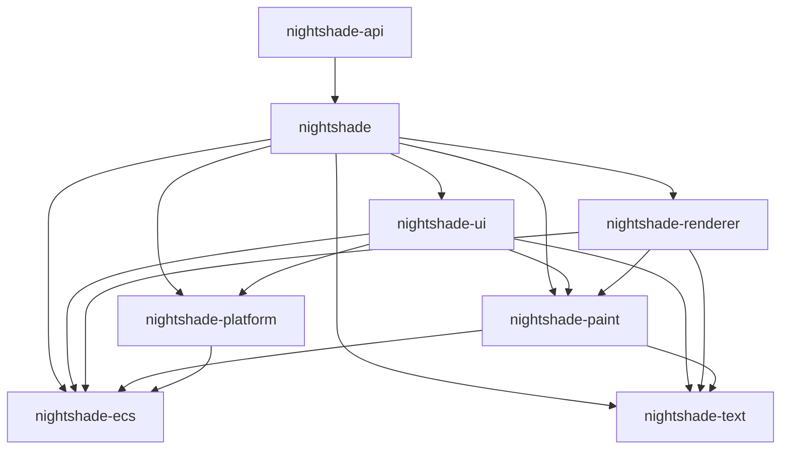

<p align="center">
  
</p>

<p align="center">
  <a href="https://github.com/matthewjberger/nightshade"></a>
  <a href="https://crates.io/crates/nightshade"></a>
  <a href="https://docs.rs/nightshade"></a>
  <a href="https://matthewjberger.github.io/nightshade/book/"></a>
</p>

`Nightshade` is a data-oriented 3D game engine written in Rust. It targets native (Windows, macOS, Linux) and the web via WebGPU, ships a glTF-first PBR renderer with the full KHR extension set, and comes with a browser-playable scene editor.


> Pre-1.0. APIs are still shifting and the project is not yet accepting external contributions. The renderer, editor, and ECS are usable today on Windows, Linux, and modern Chromium / Firefox builds.

## Highlights

- Clustered forward PBR renderer with shadows, IBL, OIT transparency, and post-processing (bloom, SSAO, tone mapping, color grading).
- Full glTF 2.0 support including the KHR extensions: transmission, volume + attenuation, anisotropy, iridescence, dispersion, sheen, clearcoat, diffuse transmission, specular, emissive strength, variants, gpu instancing.
- HDR environments (`.hdr`) and procedural atmospheres (day / night cycle, nebula, space) with prefiltered IBL.
- Skeletal animation, morph targets, and a clip player driven by a frame schedule.
- Data-oriented ECS via [nightshade_ecs](https://github.com/matthewjberger/nightshade_ecs) with archetype storage and bitflag components.
- High level procedural API ([nightshade-api](https://crates.io/crates/nightshade-api)): full 3d scenes and small games as straight-line code, free functions over plain data, with the whole engine one import away.
- Retained-mode UI with Taffy layout, theming, icons, and a built-in test driver.
- Physics ([rapier3d](https://rapier.rs)), audio ([kira](https://github.com/tesselode/kira)), gamepad ([gilrs](https://gitlab.com/gilrs-project/gilrs)), navmesh, particles, decals, picking.
- Scene authoring editor that runs in the browser or as a desktop webview app, with the engine in a web worker, a Leptos interface, gizmos, undo, and Khronos and Polyhaven asset browsers.
- Same code path on native and web. Native uses DX12 / Metal / Vulkan, the browser uses WebGPU.

## Live Demo

[Try the editor in your browser](https://matthewberger.dev/nightshade). Requires a WebGPU-capable browser (Chromium 113+, Firefox 141+, Safari Technology Preview 18+).


## Apps

Example apps in [`apps/`](apps/). Each is buildable with `just run-app <name>`.

<table>
<tr>
<td width="50%" valign="top">

<br><b><a href="apps/winter">winter</a></b>
<br><sub>Outdoor snow scene. Atmospheric lighting, large terrain, animated foliage, animated characters.</sub>
</td>
<td width="50%" valign="top">

<br><b><a href="apps/navmesh">navmesh</a></b>
<br><sub>Terrain, grass, and pathfinding. Heightmap-driven grass regions, navmesh baking, AI navigation.</sub>
</td>
</tr>
<tr>
<td width="50%" valign="top">

<br><b><a href="apps/fireworks">fireworks</a></b>
<br><sub>GPU particle system. Bursts, chrysanthemums, rings, glitter, and patterned shape emitters.</sub>
</td>
<td width="50%" valign="top">

<br><b><a href="apps/destructible">destructible</a></b>
<br><sub>First-person destructible sandbox. Runtime convex mesh slicing, physics rubble, and multiple cutter tools.</sub>
</td>
</tr>
<tr>
<td width="50%" valign="top">

<br><b><a href="apps/lights">lights</a></b>
<br><sub>Clustered forward rendering with 1024 dynamic point lights culled per froxel.</sub>
</td>
<td width="50%" valign="top">

<br><b><a href="apps/tower_defense">tower_defense</a></b>
<br><sub>Grid-based tower defense with multiple tower types, enemy waves, and pathfinding.</sub>
</td>
</tr>
</table>

## glTF Showcase

Conformance shots of [Khronos glTF Sample Assets](https://github.com/KhronosGroup/glTF-Sample-Assets) rendered in the Nightshade editor. Demonstrates the engine's PBR pipeline and KHR material extensions.

### Transmission & Volume

Refractive glass, volumetric absorption, and chromatic dispersion. Transmissive materials route through weighted-blended OIT with a screen-space scene-color sample for refraction.

<table>
<tr>
<td width="50%" valign="top">

<br><b>Dragon Attenuation</b>
<br><sub><code>KHR_materials_transmission</code> <code>KHR_materials_volume</code> <code>KHR_materials_ior</code></sub>
<br><sub>Volume attenuation through a thick glass dragon. Beer-Lambert absorption tinting and IOR-driven refraction.</sub>
</td>
<td width="50%" valign="top">

<br><b>Dragon Dispersion</b>
<br><sub><code>KHR_materials_dispersion</code> <code>KHR_materials_volume</code></sub>
<br><sub>Chromatic dispersion split into per-wavelength refraction directions, producing visible R/G/B fringing on glass edges.</sub>
</td>
</tr>
<tr>
<td width="50%" valign="top">

<br><b>Compare Transmission</b>
<br><sub><code>KHR_materials_transmission</code> <code>Roughness on glass</code></sub>
<br><sub>Smooth and frosted glass bowls side by side. The frosted version exercises roughness applied to refraction.</sub>
</td>
<td width="50%" valign="top">

<br><b>Glass Vase with Flowers</b>
<br><sub><code>KHR_materials_transmission</code> <code>KHR_materials_volume</code> <code>Multi-mesh transmission</code></sub>
<br><sub>Real-world asset with opaque flora inside transmissive glass. Tests transmission against complex opaque occluders.</sub>
</td>
</tr>
</table>

### Advanced Shading

Anisotropic GGX, thin-film iridescence, sheen, and clearcoat layers stacked on top of the PBR base.

<table>
<tr>
<td width="50%" valign="top">

<br><b>Anisotropy Compare</b>
<br><sub><code>KHR_materials_anisotropy</code> <code>Anisotropic GGX</code></sub>
<br><sub>Brushed-metal directional reflections driven by anisotropy strength, rotation, and tangent-space direction maps.</sub>
</td>
<td width="50%" valign="top">

<br><b>Iridescence Compare</b>
<br><sub><code>KHR_materials_iridescence</code></sub>
<br><sub>Thin-film interference colors that shift with viewing angle. Driven by film thickness and IOR.</sub>
</td>
</tr>
<tr>
<td width="50%" valign="top">

<br><b>Sheen Chair</b>
<br><sub><code>KHR_materials_sheen</code> <code>Velvet / cloth</code></sub>
<br><sub>Velvet upholstered chair driven by the sheen extension. Soft Fresnel-based sheen layer stacks on top of the underlying PBR base.</sub>
</td>
<td width="50%" valign="top">

<br><b>Compare Clearcoat</b>
<br><sub><code>KHR_materials_clearcoat</code> <code>Layered specular</code></sub>
<br><sub>Side-by-side clearcoat variations. A second specular layer over the base material, with its own roughness, models car paint and lacquered finishes.</sub>
</td>
</tr>
</table>

## Hello, Nightshade

```rust
use nightshade::prelude::*;

fn main() -> Result<(), Box<dyn std::error::Error>> {
    App::new()
        .add_plugins(DefaultPlugins)
        .add_plugin(SpinCubePlugin)
        .run()
}

#[derive(Default)]
struct SpinCube {
    cube: Option<Entity>,
    time: f32,
}

struct SpinCubePlugin;

impl Plugin for SpinCubePlugin {
    fn build(&self, app: &mut App) {
        app.insert_resource(SpinCube::default());
        app.add_system(Stage::Startup, initialize);
        app.add_systems(Stage::Update, (pan_orbit_camera_system, spin));
    }
}

fn initialize(game: &mut SpinCube, world: &mut World) {
    world.res_mut::<nightshade::render::config::RenderSettings>().atmosphere = Atmosphere::Nebula;
    let camera = spawn_pan_orbit_camera(
        world,
        Vec3::zeros(), 5.0, 0.5, 0.3,
        "Camera".to_string(),
    );
    world.resources.active_camera = Some(camera);
    spawn_sun(world);
    game.cube = Some(spawn_mesh_at(world, "Cube", Vec3::zeros(), Vec3::new(1.0, 1.0, 1.0)));
}

fn spin(game: &mut SpinCube, world: &mut World) {
    game.time += world.res::<nightshade::ecs::time::Time>().delta_time;
    if let Some(entity) = game.cube
        && let Some(transform) = world.get_mut::<LocalTransform>(entity)
    {
        transform.rotation = nalgebra_glm::quat_angle_axis(game.time, &Vec3::y_axis());
    }
}
```

The full annotated version with three objects, materials, and animation lives in the [book's interactive demo](https://matthewjberger.github.io/nightshade/book/interactive-demo.html).

The same cube through [nightshade-api](https://crates.io/crates/nightshade-api), the procedural high level layer over the engine:

```rust
use nightshade_api::prelude::*;

fn main() {
    let mut app = open();
    let cube = spawn_cube(&mut app.world, vec3(0.0, 0.5, 0.0));
    while frame(&mut app) {
        let step = delta_time(&app.world);
        rotate(&mut app.world, cube, Vec3::y(), step);
    }
}
```

`open()` gives you a sky, a sun with shadows, a grid, an orbit camera, and physics before your first line runs, and `app.world` is the real engine world, so the full engine stays one call away. The [book's high level API section](https://matthewjberger.github.io/nightshade/book/api-overview.html) covers the whole surface: scenes, materials, animation, cameras, input, picking, physics, immediate drawing, text, and audio.

To bootstrap a new project, use the [nightshade-template](https://github.com/matthewjberger/nightshade-template), which scaffolds the dependencies, justfile, and trunk config.

## Quickstart

Install [just](https://github.com/casey/just), then:

```bash
just install-deps   # installs mise and the pinned editor toolchain (wasm-bindgen, wasm-opt, trunk)
just run            # editor as a desktop app (webview hosting the web build)
just run-web        # editor in the browser at http://127.0.0.1:8080
just run-agent      # editor with the MCP agent endpoint at http://127.0.0.1:8790/mcp
just run-app <name> # native app from apps/ (sandbox, game, ...)
cd site && just serve   # full local site with editor + book
```

The editor is a web app either way: `just run-web` serves it with trunk, and `just run` opens the same bundle in a native webview window. The desktop shell supports multiple windows: the first instance hosts a [hearsay](https://crates.io/crates/hearsay) broker and File > New window spawns additional editor processes that join it. The Workspace menu saves every window's layout into a named workspace with recents and an optional startup workspace, and each window can save, load, and reset its own named layout from the View menu. `just run-agent` builds everything with the opt-in `agent` feature so an MCP client like Claude Code can drive the live editor (register once with `claude mcp add --transport http nightshade-editor http://127.0.0.1:8790/mcp`, see [EDITOR_AGENT.md](docs/EDITOR_AGENT.md)). Run `just` with no arguments to list every recipe.

To install the editor as a standalone desktop app without cloning the repo:

```bash
cargo install --locked nightshade-editor
```

The `--locked` flag matters: it builds with the dependency versions the release was tested against instead of resolving fresh, which protects the install from breakage in newly published transitive dependencies.

## Architecture

Nightshade is a set of crates in a strictly layered, acyclic dependency graph: each crate names only the crates below it, and Cargo turns an upward reference into a compile error. `nightshade-ecs` and `nightshade-text` are the leaves; `nightshade` is the composition root that assembles the rest; `nightshade-api` is the high-level facade.



The `nightshade` crate is layered internally too: the `World` substrate, then the ECS domains (transforms, cameras, meshes, and the rest), then the engine assembly, the capability plugins, and the app builder and runner on top. Rust allows module cycles within a crate, so that layering has no compiler behind it. `just lint-dag` (the `tools/dag-check` binary) parses the module references, runs a strongly-connected-components pass, and fails the lint gate if any layer reaches back up. The [Architecture Overview](https://matthewjberger.github.io/nightshade/book/architecture-overview.html) walks through both graphs.

## Documentation

- 📖 [Book](https://matthewjberger.github.io/nightshade/book/) - architecture, systems, and tutorials
- 🦀 [docs.rs](https://docs.rs/nightshade) - generated API reference
- 🎯 [nightshade-api](https://crates.io/crates/nightshade-api) - the procedural high level layer ([book section](https://matthewjberger.github.io/nightshade/book/api-overview.html))
- 📚 [USAGE.md](docs/USAGE.md) - engine usage, conventions, gotchas
- 🧪 [UI_TESTING.md](docs/UI_TESTING.md) - retained UI test driver
- 📊 [PROFILING.md](docs/PROFILING.md) - tracing, tracy, chrome-trace
- 🎮 [STEAM.md](docs/STEAM.md) - Steam integration (achievements, stats, friends)
- 🛠️ [STEAM_DECK.md](docs/STEAM_DECK.md) - Steam Deck deployment
- 🚀 [RELEASES.md](docs/RELEASES.md) - release process
- 📜 [LICENSING.md](docs/LICENSING.md) - third-party license notes
- 🤝 [CONTRIBUTING.md](docs/CONTRIBUTING.md) - contributor guidelines (when contributions open)

## Crate Features

Nightshade is split into composable cargo features so apps only pay for what they use. `default = ["engine", "wgpu"]`.

```
Composite:
├── core ─────────────── ECS, math, windowing, time
├── runtime ──────────── core + cosmic-text
├── engine (default) ── runtime + assets + scene_graph + picking + file_dialog + screenshot
└── full ─────────────── engine + wgpu + shell + audio + physics + gamepad + navmesh + networking + grass + terrain

Building blocks:
├── assets ───────────── glTF / image / bincode / lz4 asset loading
├── fbx ──────────────── FBX model import (ufbx)
├── scene_graph ──────── ECS scene round-trip
├── picking ──────────── entity picking
├── file_dialog ──────── native open/save dialogs (rfd)
├── file_watcher ─────── live asset reload (notify)
├── screenshot ───────── capture viewport to PNG
├── shell ────────────── in-game shell commands
└── gizmos ───────────── translate / rotate / scale gizmos

Renderer & subsystems:
├── wgpu ─────────────── GPU rendering (DX12 / Metal / Vulkan / WebGPU)
├── audio ────────────── audio playback (kira)
├── physics ──────────── 3D physics (rapier3d)
├── gamepad ──────────── controller input (gilrs)
├── navmesh ──────────── runtime navmesh queries
├── navmesh-bake ─────── navmesh baking (rerecast)
├── networking ───────── topic-based pub/sub messaging (hearsay)
├── debug_render ─────── line / shape debug overlays
├── egui ─────────────── immediate-mode egui UI overlay
├── steam ────────────── Steam integration (steamworks)
└── windows-app-icon ── embed app icon on Windows

Profiling:
├── tracing ──────────── tracing-subscriber logging
├── tracy ────────────── Tracy profiler integration
└── chrome ───────────── chrome-trace output
```

## Maintainer Tools

Only needed for release work, not for using the engine.

- [git-cliff](https://git-cliff.org/) - changelog generation
- [gh](https://cli.github.com/) - GitHub releases

## Contributing

External contributions are not being accepted yet. Architecture and core systems are still settling. Once the engine stabilises, contributor guidelines will land here.

## License

Dual-licensed under either of:

- MIT License ([LICENSE-MIT](LICENSE-MIT) or http://opensource.org/licenses/MIT)
- Apache License, Version 2.0 ([LICENSE-APACHE](LICENSE-APACHE) or http://www.apache.org/licenses/LICENSE-2.0)

at your option.

Unless you explicitly state otherwise, any contribution intentionally submitted for inclusion in `nightshade` by you, as defined in the Apache-2.0 license, shall be dual licensed as above, without any additional terms or conditions.
